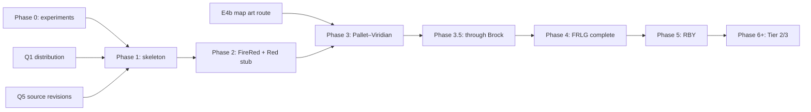

# 05 — Roadmap

Status: **proposal** for owner review (planning pass, 2026-11-03). It follows the brief's phases, with changes marked
**Change** and the reason given.

## Phase 0 — Validate the foundation

Goal: prove on the owner's machine that pokebw2 can be built, changed and booted in every way Kaleido needs, and
measure the limits. Each experiment is recorded in `docs/research/e<N>-<topic>.md` with commands, the pokebw2 commit,
results and the risk it retires.

Prerequisites (owner): Black 2 (USA/Europe) dump in the WSL checkout's `orig/`; build tools in WSL (`sudo apt install
ninja-build clang llvm python3.14-venv`; Ubuntu 26.04's Python lacks `venv` without it); a FireRed dump of the chosen
revision for E8; hardware for E7.

| ID | Experiment | Done when | Retires |
| --- | --- | --- | --- |
| E0 | Build pokebw2 at the pin in WSL2 (WSL filesystem) | `build/pokeblack2_us.nds` matches `e51e6dfb…`; build time, disk use and tool versions recorded; a second clean build gives the same hash | R-12, R-18 (part) |
| E1 | Change text | Edited script message shows in game; a non-ASCII character and a full-width line are tested | R-11 (part) |
| E2 | Change data through `res/` JSON | Edited trainer party appears in battle | — |
| E3 | Change battle code | Crit formula changed under a `KALEIDO_` define passed through a minimal `configure.py` patch; `--shift`-style modified build boots and battles; the new rate observed over many trials or by watching RAM. With the define off, the build still matches. Proves the `KALEIDO_` define path that B2W2-system switches and the DS Protect guard need (the crit change itself is a test, not a planned feature) | R-02 (part), define mechanism |
| E4a | New zone, existing art | New zone constant, header, events, warps both ways and a script, using an existing map model; works in game | R-17 (part) |
| E4b | New map art | Try to add a **new** map model from glTF and a **new** texture set. Expected to fail with upstream's packers (`pokebw2.md`); result is a scoped plan (and estimate) for an encoder that can, or proof that repurposing existing chunks is enough | **R-01** |
| E5 | Species #650 end to end | One new species with data, sprites, icon, cry, Pokédex entry, catchable and saved; every table and limit touched is listed with its cost | R-14 |
| E6 | Measure headroom | DS-mode and DSi-mode free main RAM and heap at field, battle and menu; free space in overlay regions; ARM9 binary size against the DSi's 2.5 MB limit; ROM size used against the 512 MB ceiling; save bytes used against the save area | R-05, R-17, R-26 |
| E7 | Boot on hardware | E0's and E3's ROMs (with DS Protect guarded out) on each device the owner has, in DS mode and DSi mode, through each loader (flashcart kernel, nds-bootstrap/TWiLight Menu++, Unlaunch) and in melonDS direct and firmware boot; no anti-piracy effects; save survives a power cycle; decide whether a DS-only build is needed | R-04, R-25 |
| E8 | Extract a FireRed table | Route 1's encounter table read from the owner's FireRed ROM (SHA1-checked) into `res/field/encounters/` JSON, deterministically, with nothing ROM-derived committed; shown in game on E4a's zone | R-10 |
| E9 | Save identity | A per-game save signature refuses B2 saves and another Kaleido game's saves; flashcarts keep detecting the save type with B2's header game code | R-13 |
| E10 | Regenerate `res/` from a ROM (optional; may slip to Phase 1) | Upstream's extraction scripts rebuild `res/` from the owner's ROM; diff against upstream's `res/` | R-03 |

**Change**: E0 is added explicitly, E4 is split (an existing-art zone is cheap and certain, new map art is the real
risk), and E9 and E10 are added because save identity and upstream availability are architecture risks.

Done on 2026-11-03 (`docs/research/e0-baseline.md`): E0a, the no-ROM compile of every C file (3,584 of 3,584), and
E0, the matching build, which reproduced Black 2's SHA1 twice from clean. E4b (`docs/research/e4b-map-art.md`):
upstream refuses new map art; a template-append prototype adds a new chunk and texture set to a ROM that builds and
plays normally in melonDS; ADR 0003 accepted. E6a (`docs/research/e6-headroom.md`): ROM ≈ 231 MiB free; ARM9 far
under the DSi limit; DS-mode RAM is the constraint, at ≈ 213 KiB for all added code and static data. E6b (runtime
free memory, save use) is defined and still to do. E1–E3 (`docs/research/e1-e3.md`): `--define` and a crit switch;
switch off still matches; edits verified in the built ROM; E1's text shows in game; the rival battle (E2, E3) is
still to be checked in game.

**Change (2026-11-03)**: manual in-game checks are batched into a playtest pass at the end, not done after each
experiment (owner's decision). A Phase 0 experiment counts as done on build-level verification, with its in-game check
listed in `docs/status.md` ("Deferred to playtesting").

E4a (`docs/research/e4a-new-zone.md`): a new zone's data packs and reads back correctly. Appending zones needs a
"no zone" sentinel fix in ARM9 main, and any ARM9 main change needs the DS ARM7 BIOS to finish the ROM (R-27).
ADR 0004: Tier 1 reuses zone IDs, and a dsd flag (`--allow-stale-secure-area`) builds without the BIOS. E4a's ROM
now builds.

**Change (2026-11-03)**: the owner has no hardware yet (Q4), so E7 runs when devices are available, not as a Phase 0
gate. Until then, E7's checks run on melonDS in DS mode and DSi direct boot. Hardware validation is still required to
exit Phase 3.5.

Exit criteria:

- E0–E6 and E8–E9 recorded; E10 recorded or rescheduled; E7 recorded or waiting for hardware.
- ADR 0002 (engine integration) accepted (done 2026-11-03).
- An ADR on how new map art gets into the ROM, from E4b: ADR 0003, accepted 2026-11-03.
- `01-feasibility.md` and `docs/risks.md` updated with the results.

## Phase 1 — Framework skeleton

Depends on: Phase 0 exit; Q1 and Q5 (answered 2026-11-03); the owner's FireRed dump, whose revision becomes the
first extraction target.

Deliverables:

- Repo layout from `03-architecture.md` §3; `LICENSE`, `LICENSE-CONTENT`, `CONTRIBUTING.md`, `docs/building.md`,
  `docs/architecture.md`, `docs/engine-sync.md`.
- Engine submodule and the first patches (Kaleido defines and content overlay for `configure.py`).
- `kaleido doctor`, `bootstrap`, `extract`, `merge`, `validate`, `build`, `patch`, `baseline`.
- Layer merge with provenance and schema validation; one game config (`firered`) with a tiny layer (E1's text change,
  E4a's zone, E8's encounter table).
- CI on GitHub Actions (no ROMs): lint, unit tests, schema/provenance/cross-reference checks on committed layers,
  `compile_all.py` for each game's define set, ROM-file guard. Actions pinned to commit SHAs, read-only permissions,
  timeouts, one required check, added to the "Protect main" ruleset once it reports.
- Dependabot: weekly, grouped updates for `pip` and `github-actions`.

Exit criteria:

- A clean clone on a second machine builds the same ROM SHA1 and patch SHA1 as the first.
- `kaleido baseline` still matches Black 2's SHA1.
- CI is green and needs no ROM.
- Applying the patch to the base ROM yields the built ROM's SHA1.

## Phase 2 — Two builds

Depends on: Phase 1.

**Change**: build **FireRed** and a **Red** stub, not FireRed and LeafGreen. There are no rulesets (every game uses
Gen 5 mechanics, Q6), so the brief's "ruleset flag" becomes a compile-time B2W2-system switch (Q7). FireRed and Red
share the Kanto region and differ by family, a switch and data, which exercises the whole hierarchy. LeafGreen
follows in Phase 4 as a plain version variant.

Exit criteria:

- Both ROMs boot on melonDS in DS mode, and on one hardware device if the owner has one by then.
- Both patches apply to the B2 base ROM and give the expected SHA1s.
- The difference is visible in game: title and starting text differ, and one B2W2 system (for example the C-Gear)
  is present in one build and absent from the other.
- Each game refuses the other's save (E9's mechanism).

## Phase 3 — Prototype: Pallet Town to Viridian City

Depends on: Phase 2; the new-map-art route chosen after E4b.

Scope: Pallet Town, Route 1, Viridian City (Pokémon Center, Mart), Oak's Lab, player's house; NPCs and signs; dialogue
extracted from FireRed; wild encounters; at least one trainer; Oak's Parcel progression; new-game start in Pallet Town.
First per-game switches for the B2W2 systems that show up on this path (C-Gear, seasons, Pass Powers, Unova
Pokédex), with FireRed's config choosing each (Q7).

Exit criteria:

- Playable on melonDS from New Game to delivering Oak's Parcel.
- Validation is clean; provenance covers every file.
- Art cost per map recorded, for the estimate below.

## Phase 3.5 — Vertical slice: through Pewter City and Brock

Depends on: Phase 3.

Scope: Route 2, Viridian Forest, Pewter City, Pewter Gym and Brock (badge, TM reward, gym trainer AI), Pokémon Center
healing, Mart purchases, a cave (proposal: Mt. Moon 1F, the next cave on the path), save/load round trip.

Exit criteria:

- The slice plays through on melonDS and on hardware (each device from E7). This is the latest point at which the
  owner needs a device (Q4).
- A save made mid-slice loads correctly after a power cycle on hardware.
- Fidelity of everything in the slice classified (Exact/Approximate/Infeasible) and checked against `01-feasibility.md`.
- Per-map, per-sprite and per-script effort measured; the full-game estimate updated.

## Phase 4 — FireRed and LeafGreen complete

Depends on: Phase 3.5.

Scope: all of Kanto, the Elite Four and Champion, postgame and the Sevii Islands, version exclusives, LeafGreen as a
version layer. Content and test patterns (checklists, scripted emulator tests) established and documented.

Exit criteria: both games complete start to Hall of Fame and through the Sevii postgame on melonDS; hardware smoke
tests on each device; every feature in `01-feasibility.md` has a final classification.

## Phase 5 — Red, Blue and Yellow

Depends on: Phase 4 (Kanto region data).

Scope: RBY family and games over the Kanto region, with Gen 5 mechanics (Q6, Q9); Gen 1 content differences from
FRLG as family and game overrides; Approximations as listed in `01-feasibility.md`.

## Phase 6+ — Tier 2, then Tier 3

Re-planned when reached. Inputs from now: E5 (species expansion cost), White2Upgrade's findings on Fairy
(`peripheral-tools.md`), and the requirements list in `01-feasibility.md`.

## Dependencies

## Workload: art and content versus engine

The brief expects art and content to cost more than engine work. The counts below support that. The time per item is
**not** estimated yet: Phase 3 and 3.5 measure it, and this section is rewritten then.

| Item | Count | Reuse from B2W2 (category 1) | Source of the count |
| --- | --- | --- | --- |
| FRLG maps | 425 (147 Sevii/Navel/Birth/Trainer Tower; ~278 mainland) on 367 layouts | Generic interiors (Pokémon Center, Mart, houses, gates) map onto B2W2's | pokefirered `ce6406d8` tree |
| FRLG tilesets | 2 primary, 66 secondary | Some textures (water, grass, trees); Kanto towns need their own sets | same |
| Trainer battle sprites | 146 FRLG front pictures | 11 Kanto characters already in B2W2 (Red, Blue, Giovanni, Lance, Brock, Misty, Lt. Surge, Erika, Janine, Sabrina, Blaine) plus overlapping generic classes | same; `pokebw2.md` |
| Overworld people sprites | 96 FRLG | Many B2W2 actors fit generic NPCs (385 actor directories) | same |
| Pokémon sprites, icons, cries | 386 species | **All** present in B2W2 | `pokebw2.md` |
| Music | FRLG soundtrack | B2W2 has 273 BGM sequences, including one Kanto leader battle remix (`SEQ_BGM_VS_RG_LEADER`) | `generated/sound.txt` |
| Scripts | every event of 425 maps | none (hand-written, category 3) | — |
| Dialogue, parties, encounters, learnsets | all of FRLG | none (extracted, category 2) | — |

Engine work for Tier 1, by contrast, is a bounded list: Kaleido defines and overlay support, new map art support (E4b),
per-game switches for B2W2 systems, the DS Protect guard, a Kanto regional Pokédex, and a few FRLG key items. With Gen
5 mechanics everywhere (Q6), there are no battle or field variants. Its sizes come from E3, E4b and E6.

Music deserves its own decision. FRLG's songs are other-game content. Using them means converting the GBA sequence
format to Nitro SSEQ/SBNK/SWAR at build time (a converter we would have to write). The alternative is original
arrangements (category 3, heavy art cost) or reusing B2W2 tracks (Approximate). Decided in Q6: prototype converting
one FRLG song in Phase 3, then choose. See R-24.
